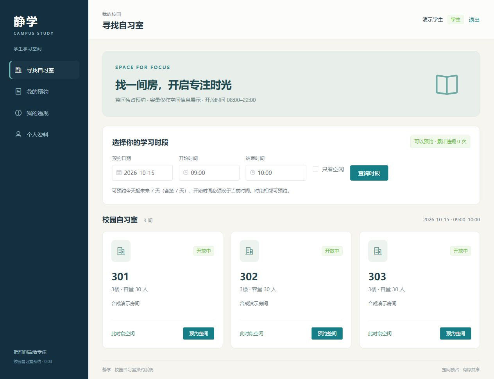

# 校园自习室预约系统

基于 **Spring Boot + Vue2 / Element-UI + MySQL8** 的软件工程课程首版，实现学生和管理员两种角色、六个业务模块。当前用于本机合成数据演示；真实学生身份接入、学校平台提交和生产部署尚未执行。



## 已实现功能

| 学生 | 管理员 |
| --- | --- |
| 注册、登录、修改姓名与联系方式 | 查看学生账号和预约权限 |
| 查询房间、日期及空闲时段，整间独占预约 | 房间增改、开关和软删除，保留历史 |
| 查看本人预约，开始前取消 | 查看全部预约，异常取消并记录原因 |
| 查看违规记录及预约权限状态 | 依据证据确认到场、迟到、爽约和完成 |
| 取消后资源释放，历史保留 | 违规误判撤销、有效计数重算、三次封禁 |
| 数据持久化，接口验证所有权 | 查看预约率和基于管理员事件的使用率 |

用户已明确选择整间独占，容量仅展示。预约采用上海时区、同日08:00–22:00的半开区间，默认可约今天至后续7天；只有取消释放原时段。未知到场不会被定时自动判爽约。详见[业务规则](docs/product/首版业务规则与验收.md)和[API契约](docs/product/API契约.md)。

## Windows 快速运行

环境需要 **JDK21**、Node.js 22/24；项目脚本可单独下载Maven、npm和MySQL8。本轮电脑上的工具与数据库已准备完成，在项目目录执行：

```powershell
# 恢复依赖、检查前端、构建前后端、运行17项集成测试、保存依赖审计。
.\build.bat

# MySQL3307若已停止则恢复，保留原有数据。首次需先bootstrap -WithMySql。
powershell -NoProfile -ExecutionPolicy Bypass -File scripts/start-local-mysql.ps1

# 默认真实MySQL；隐藏启动前后端并打开页面。
.\start.bat
```

打开 [http://127.0.0.1:5173](http://127.0.0.1:5173)，后端为8080。本机独立MySQL为3307，所有服务只监听本机。`stop.bat`仅停止本项目前后端，保留MySQL和持久数据。

从GitHub克隆到新电脑后，先在仓库目录执行：

```powershell
# 工具从官方来源下载；Maven/npm/可选Node校验官方摘要。
powershell -NoProfile -ExecutionPolicy Bypass -File scripts/bootstrap.ps1 -WithMySql
# 如果未安装Node且没有Codex运行时，可在上一命令追加-WithNode。
powershell -NoProfile -ExecutionPolicy Bypass -File scripts/start-local-mysql.ps1
.\build.bat
.\start.bat
```

启动脚本不会停止已有其他Java/Node/MySQL。端口被其他项目占用会停止并提示；中文路径的MySQL使用受控ASCII目录联接，仍访问本项目独立数据。

### 合成演示账号

仅在本地 `DEMO_SEED=true` 或显式 `demo` profile初始化后可用：

| 角色 | 账号 | 合成演示密码 |
| --- | --- | --- |
| 管理员 | `admin` | `Admin123!` |
| 学生 | `20260001` | `Student123!` |

这些是公开的合成演示凭据，不能用于真实部署。正式配置默认不创建演示账号；数据库随机口令保存于被忽略的 `.data/`，不上传GitHub。示例环境变量见 [.env.example](.env.example)。

### 使用已有MySQL

自行建立空的 `study_room_reserve` 库和最小所需权限账号，再设置环境变量。Flyway执行新迁移，Hibernate验证结构；不删除既有数据，不自动接管原报告旧四表。

```powershell
$env:DB_URL='jdbc:mysql://127.0.0.1:3306/study_room_reserve?useUnicode=true&characterEncoding=utf8&serverTimezone=Asia/Shanghai'
$env:DB_USERNAME='study_room'
$env:DB_PASSWORD='替换为本机数据库口令'
$env:DEMO_SEED='true' # 只对独立合成开发库启用；正式环境false。
.\start.bat
```

也可用 `start.bat -Demo` 显式选择H2内存演示，停止后数据清空；这不能当作MySQL验证。

## 结构和注释

```text
backend/          Spring Boot接口、实体、事务服务、Flyway及JUnit
frontend/         Vue2页面、角色路由、API与上海时间/密码校验
database/         数据模型及迁移说明
scripts/          工具准备、构建、启动、停止、独立测试入口
docs/product/     规则、接口与基于证据的业务复核
docs/technical/   前后端实施及运行说明
docs/testing/     独立测试、脱敏摘要及浏览器证据
开发日志/开发日志0.03/  本轮派发、实施、验证及AI调用
.codex/agents/    四角色提示词与用户指定模型配置
```

类、方法、接口、实体字段、SQL、组件事件、事务/锁与统计口径均保留中文注释。实现遵循服务端认证、数据所有权、密码哈希、用户→房间→订单锁序、活动违规唯一约束和追加审计，不以页面跳转或单线程先查后插替代安全与并发校验。

## 验证与实际限制

独立测试在H2和真实MySQL8.0.44上各17项通过，包含两组8请求预约竞争、同单违规竞争、关房竞争、事务故障回滚、16小时会话到期、统计复算及UTF-8密码边界。见[独立测试报告](docs/testing/独立测试报告.md)和[脱敏执行摘要](docs/testing/执行记录/脱敏执行摘要.md)。

```powershell
# 默认H2独立测试。
powershell -NoProfile -ExecutionPolicy Bypass -File scripts/testing/run-independent-tests.ps1
# 已准备本地独立study_room_test时，切换真实MySQL验证，不清理应用库。
powershell -NoProfile -ExecutionPolicy Bypass -File scripts/testing/run-independent-tests.ps1 -MySql
```

17为测试方法数，不等于所有业务验收分支全部通过。浏览器完成学生预约/取消/资源释放、管理员登录/统计/房间增删和390像素布局检查；未验证吞吐指标、真实校园认证、全部管理状态组合或真实用户体验。完整范围及未覆盖项见[产品复核](docs/product/首版业务验收复核.md)。

依赖审计已消除Vite/esbuild告警；保留用户指定Vue2/Element-UI后仍有3项低等级、1项中等级告警。构建将审计报告写到 `artifacts/build/npm-audit.json`，按课程口径不因审计退出码阻断编译/单测，不自动执行破坏性的 `audit fix --force`。日报使用管理员确认事件估计，没有传感器或历史开放日历。

开放窗口固定08:00–22:00；如改后端`booking-days`，需要同步前端日历和验收，不能只改一个值宣称全系统配置已适配。原课程资料、含个人来源路径的0.01/0.02日志、原始工具日志与数据库凭据仅本地保存，不纳入公开仓库。课堂讨论、现场答辩、团队/教师签字与学校平台提交仍由本人完成。
